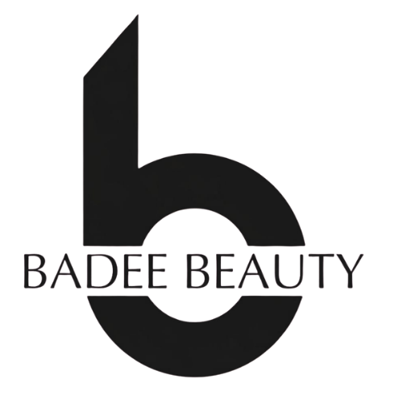
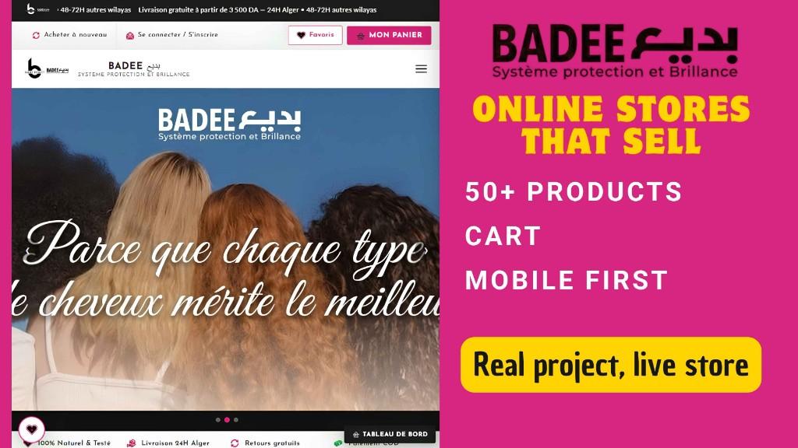
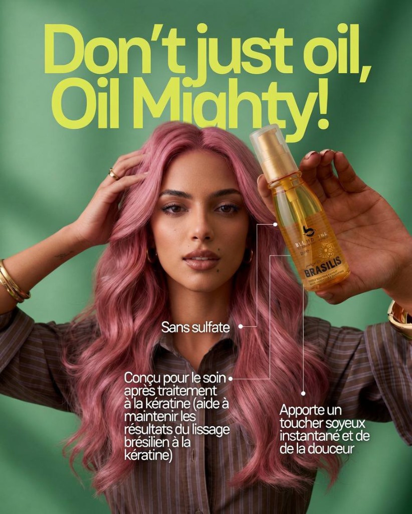

<p align="center">
  
</p>

<h1 align="center">BADEE BEAUTY</h1>

<p align="center">
  <em>Système protection et Brillance</em><br/>
  <strong>Parce que chaque type de cheveux mérite le meilleur.</strong>
</p>

<p align="center">
  
  
  
  
</p>

---

<p align="center">
  
</p>

<h2 align="center">ONLINE STORES THAT SELL</h2>

<p align="center">
  Real project. Live store. Built for Algeria — from shade pickers to wilaya checkout.
</p>

| | |
|:--|:--|
| **50+ PRODUCTS** | Catalogue, variants & shade swatches that shoppers actually use |
| **CART** | Wishlist + panier drawers, COD-ready checkout, order confirmation |
| **MOBILE FIRST** | Thumb-friendly nav, full-bleed hero, admin dashboard in the pocket |

---

## Don't just ship — ship mighty

<p align="center">
  
</p>

Badee isn’t a template with lipstick on. It’s a **beauty storefront with a pulse**: editorial hero, ritual blog, keratin-care storytelling, and a cart that respects how people shop in Algeria.

Like the formulas on the shelf — **sans sulfate, aftercare-first, silky on contact** — this codebase aims for the same brief:

- **Clean** — CRA React SPA, no eject drama  
- **Stable** — Redux Toolkit for cart, auth, orders & products  
- **Soft to the touch** — calm UI, French copy, EmailJS that actually sends  

---

## What’s inside the bottle

```text
  ┌─────────────┐     Axios / JWT      ┌─────────────┐
  │  React SPA  │ ───────────────────► │  REST API   │
  │  Netlify    │                      │  products · │
  │             │ ◄── EmailJS mails ── │  orders ·   │
  └─────────────┘                      │  users      │
                                       └─────────────┘
```

| Zone | Experience |
|------|------------|
| **Vitrine** | Home hero, feature strip, product grid & detail |
| **Panier** | Cart & wishlist drawers → checkout (wilayas / communes) |
| **Histoires** | Blog index, beauty rituals, mousse & kératine pieces |
| **Compte** | Login / register · admin **Tableau de bord** |
| **Confiance** | FAQ, mission, contact, privacy, terms |

---

## Stack

| Layer | Choice |
|-------|--------|
| UI | **React 18** |
| Routing | **React Router 7** |
| State | **Redux Toolkit** + react-redux |
| HTTP | **Axios** |
| Mail | **EmailJS** |
| Scaffold | **Create React App** (`react-scripts` 5) |
| Host | **Netlify** · Node 20 |

---

## Quick start

```bash
git clone <your-repo-url>
cd badee-beauty
npm install
```

Create a `.env` at the root:

```env
REACT_APP_API_BASE_URL=https://your-api.example.com

REACT_APP_EMAILJS_PUBLIC_KEY=your_public_key
REACT_APP_EMAILJS_SERVICE_ID=your_service_id
REACT_APP_EMAILJS_TEMPLATE_CONTACT_ID=your_contact_template
REACT_APP_EMAILJS_TEMPLATE_ORDER_ID=your_order_template
```

```bash
npm start          # http://localhost:3000
npm run build      # static build/ for Netlify
```

Set the same `REACT_APP_*` vars in the Netlify UI so production can talk to your API and inbox.

---

## Project map

```text
src/
  components/   hero · nav · drawers · cards
  pages/        shop · blog · checkout · dashboard
  redux/        cart · auth · orders · products
  services/     API + EmailJS
  data/         algeria · business · copy
  routes/       admin & public-only guards
```

---

## Brand

- **Logo** · `public/logoB.png` · white / black marks in `public/`
- **Social & contact** · `src/data/business.js`
- **Tone** · FR first · soft greens & pink accents · hair that owns the frame

---

<p align="center">
  <strong>BADEE</strong> · بديع<br/>
  <em>L’éclat commence ici.</em>
</p>

<p align="center">
  Built with care by <strong>khadidja</strong>.
</p>
